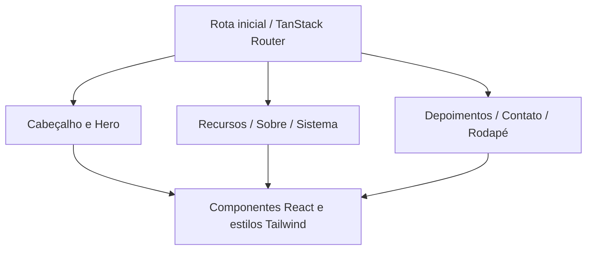

# BarberFlow Pro

### Landing page para apresentar uma solução de gestão de barbearias

**React · TypeScript · TanStack · Tailwind CSS · Vite**

Interface de apresentação comercial de um produto para barbearias. A página organiza proposta de valor, recursos apresentados, informações do produto e contato em uma experiência visual com tema escuro.

> Este repositório é uma apresentação de front-end. O código-fonte da implementação permanece privado. O escopo revisado é uma landing page; não comprova a implementação de um sistema completo de agendamento, financeiro ou atendimento.

## O problema de interface

Apresentar um produto digital exige orientar a leitura: o visitante precisa entender a proposta, explorar os recursos e encontrar um caminho de contato sem se perder em uma página extensa.

## Composição da página

| Seção | Papel na experiência |
| --- | --- |
| Cabeçalho | Identidade e navegação |
| Hero | Proposta principal e primeiro destaque |
| Recursos | Apresentação dos benefícios e funcionalidades propostas |
| Sobre e sistema | Contexto e visão do produto |
| Depoimentos | Seção de conteúdo social da interface |
| Contato e rodapé | Continuidade da navegação e encerramento |

## Arquitetura de interface

## Decisões técnicas

- **Composição por seções:** cada área da landing page possui um componente próprio.
- **TypeScript:** tipagem na base do front-end.
- **Roteamento estruturado:** rota inicial definida com TanStack Router.
- **Estilização com Tailwind:** classes utilitárias para compor a interface.
- **Metadados de página:** título e descrições definidos na configuração da rota.
- **Ferramentas de desenvolvimento:** Vite, ESLint e Prettier presentes no projeto.

## Escopo demonstrado

Construção de uma apresentação de produto em React, organização de componentes e estrutura de navegação e conteúdo. Textos promocionais da interface não são usados nesta apresentação como prova de clientes, resultados comerciais ou funcionalidades de back-end.

## O que esta apresentação demonstra

Front-end orientado à apresentação de produto, composição reutilizável de seções e uso de um ecossistema moderno de React e TypeScript.

**Projeto apresentado por [Nycolas França](https://github.com/Scorpped).**
